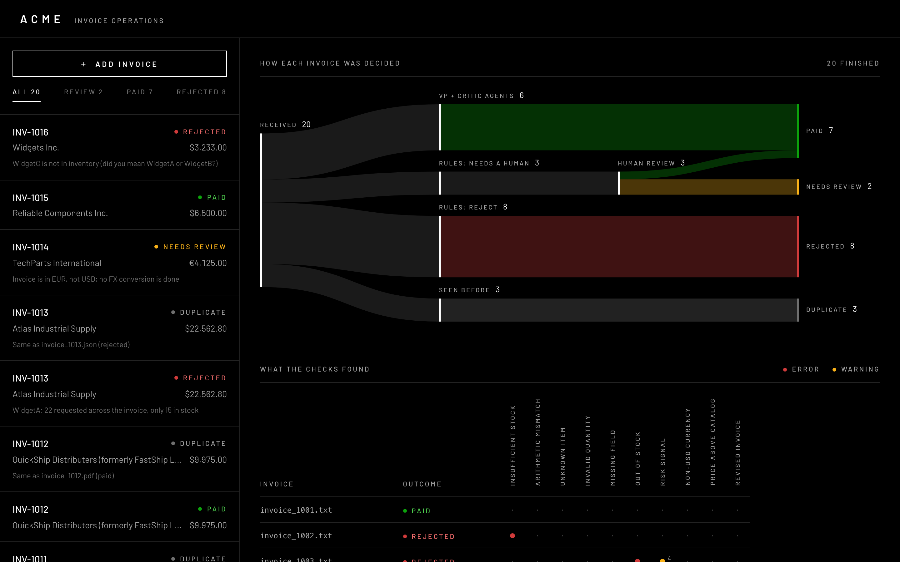
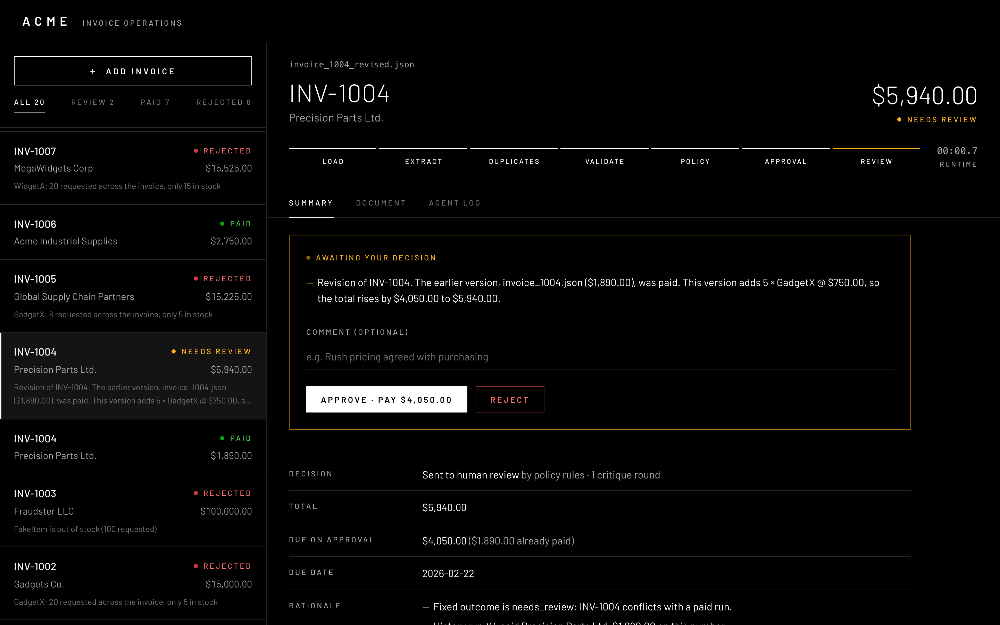
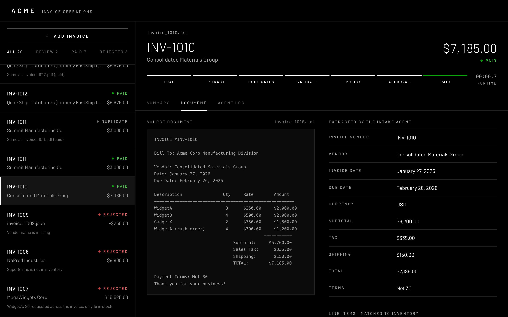
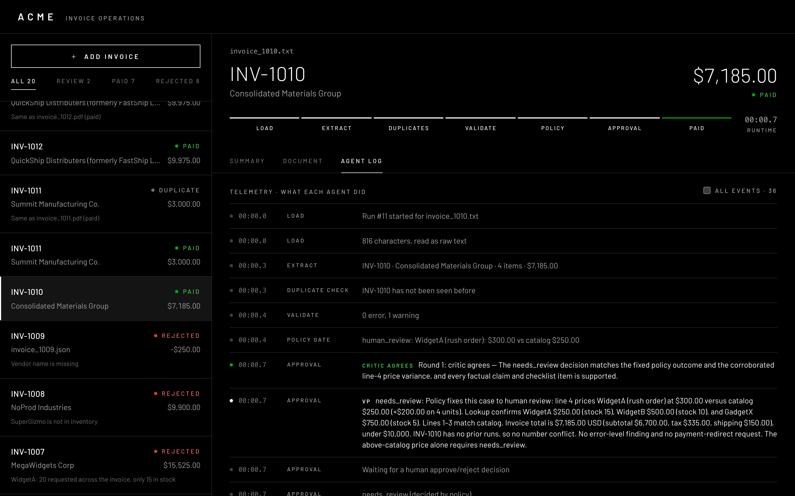
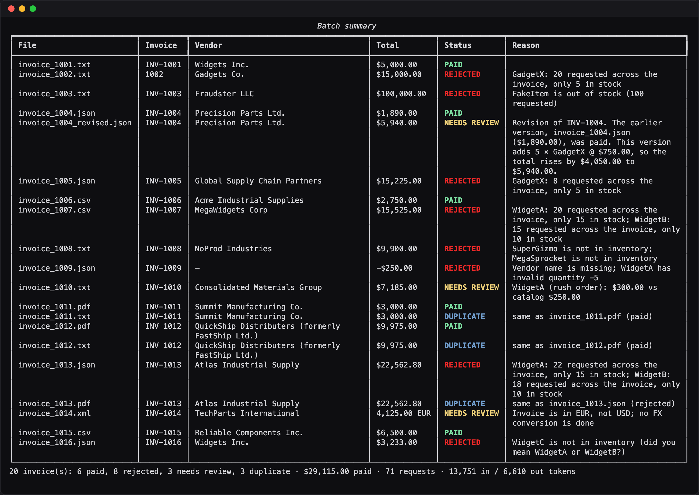

# Acme Invoice Agent

Grok agents read each invoice, match it against the inventory database, and draft a VP decision that a critic agent audits. Code enforces the approval policy and then pays or rejects. You can run it from the CLI or from a local web dashboard.


## Quick start

You need Python 3.14, [uv](https://docs.astral.sh/uv/), and an xAI API key.

```bash
uv sync
cp .env.example .env    # set XAI_API_KEY (XAI_MODEL is optional, default grok-4.7)
```

### Dashboard

```bash
uv run python main.py serve    # http://localhost:8000
```

1. Click **Add invoice**, then **Run all 20**, or upload files or drop them on the list (PDF, TXT, JSON, CSV, XML).
2. Invoices are processed one at a time in the background, and the list updates live.
3. Open an invoice to see its decision, the source document next to the extracted fields, and the agent log.
4. Invoices waiting for a human get **Approve** and **Reject** buttons.
5. Click **ACME** to go back to the overview of how every invoice was decided.

| Overview | Review |
|---|---|
|  |  |
| **Document vs. extraction** | **Agent log** |
|  |  |

The built dashboard (`web/dist`) is committed, so you don't need Node to run it. To work on the frontend, run `cd web && npm ci && npm run dev`. Vite serves it on :5173 and proxies `/api` to :8000. Run `npm run build` to rebuild `web/dist`.

### CLI

```bash
uv run python main.py --invoice_path=data/invoices/invoice_1010.txt   # one invoice
uv run python main.py --invoice_path=data/invoices/                   # a folder, then a summary
```

- **Flags:** `-v` shows LLM and tool calls. `--reset` clears the database.
- **Reviews:** in a terminal, the CLI asks you to approve or reject any invoice that needs review.
- **Shared database:** the CLI and the dashboard use the same `inventory.db`, so a review left in one can be finished in the other.




## How it works

| Step | Who | What |
|---|---|---|
| Extract | Intake agent | Reads any format into a typed invoice. Retries when the schema, the parse, or a check against the source text fails |
| Duplicates | Code | A repeated invoice ends as a duplicate. The same number with different content goes to review |
| Validate | Validation agent + code | The agent matches line items using inventory tools. Code rules check stock, arithmetic, prices, and missing fields |
| Policy | Code | Hard rules settle what they can (reject, or needs a human). The agents can't overrule them |
| Approve | VP + critic agents | The VP agent drafts a decision and the critic agent audits it, for up to 3 rounds |
| Settle | Code | Mock payment (idempotent, so it pays only the difference on a revised invoice), or a recorded rejection |

- **Audit trail:** every step is saved to SQLite as an event and logged to `logs/pipeline.jsonl`.
- **Results:** on the 20 sample invoices the system pays 6, rejects 8, sends 3 to review, and flags 3 duplicates.